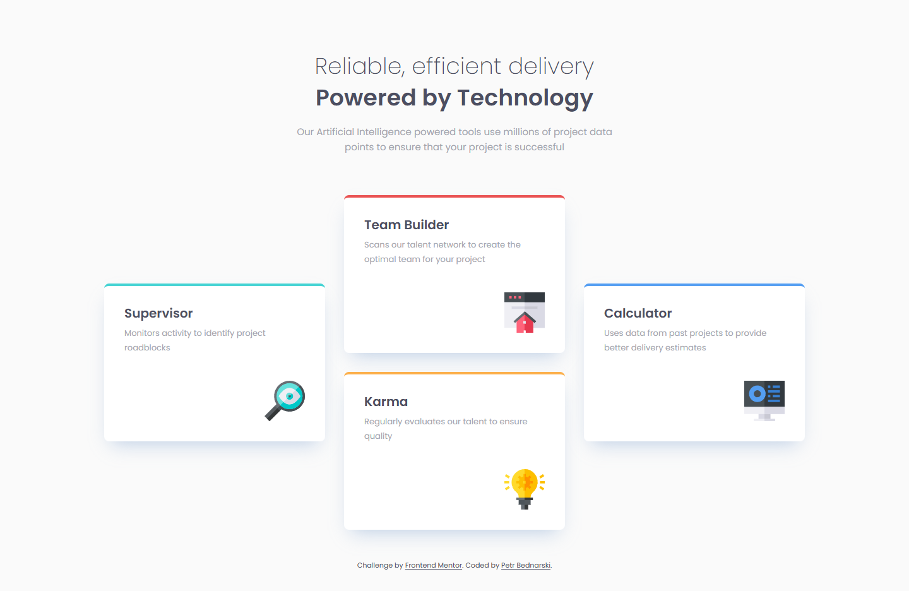
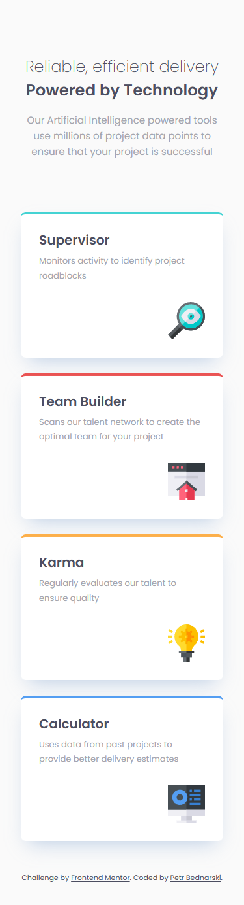

# Frontend Mentor - Four card feature section

A responsive feature section built for the [Frontend Mentor challenge](https://www.frontendmentor.io/challenges/four-card-feature-section-weK1eFYK). Four cards explain how the service supports project delivery, with a centered introduction and a layout that adapts from a single column to the desktop cross arrangement.

## Links

- [Source code](https://github.com/pettik/FrontendMentor--four-card-feature-section)
- [Challenge](https://www.frontendmentor.io/challenges/four-card-feature-section-weK1eFYK)

## Solution screenshots

These screenshots show the implemented page in Chrome, with the Poppins font loaded. They replace the older solution captures; the original challenge references remain in `design/`.

### Desktop (1440px viewport)

### Mobile (375px viewport)

## Built with

- Semantic HTML: one page heading, level-two card headings, and article elements.
- CSS Grid for the responsive card arrangement.
- Flexbox inside each card to position its decorative icon below the description.
- CSS custom properties for the challenge palette.
- Relative font sizes and `clamp()` for scalable typography.
- [Poppins](https://fonts.google.com/specimen/Poppins), loaded from Google Fonts.

No build step or JavaScript is required.

## Live site

[Live site - netlify](https://pettik-four-card-section.netlify.app/)

### Responsive layout

The grid uses `minmax(0, 1fr)` columns, and each card fills its column instead of keeping a fixed pixel width. The layout uses three columns above `64rem`, two columns between `40rem` and `64rem`, and one column at `40rem` or below. At the default browser font size, those breakpoints are 1024px and 640px.

On desktop, Supervisor and Calculator span both grid rows and sit beside the two middle cards. At narrower widths, their explicit grid positions reset so the visual order follows the document: Supervisor, Team Builder, Karma, Calculator.

Cards use a minimum height and can grow with their text. This keeps descriptions and icons from overlapping when text is enlarged or wraps onto more lines.

### What I learned

A grid track can shrink while a fixed-width child still overflows it. Combining flexible tracks, `width: 100%`, and `min-width: 0` lets the cards adapt at intermediate widths.

The introductory line is a paragraph, followed by the page's `h1`. Each card has an `h2`, so its content is easy to find using heading navigation. Icons use empty alternative text because the adjacent headings already convey their meaning.

Using `rem` for text and minimum card heights respects the browser's base text size. Testing enlarged text also exposed the need to wrap long words in narrow layouts.

### Continued development

A useful next step is to compare font loading and line wrapping across Firefox and Safari. Self-hosting Poppins could also remove the external font request.

For future changes, keep commits focused on one purpose and describe the result, for example `Fix card overflow at tablet widths` or `Document the finished responsive solution`.

## Validation

The updated solution was checked in Chrome:

- 77 viewport widths from 320px to 1440px, including both sides of each breakpoint and the previously problematic 769px range.
- 200% base text size at 320, 375, 640, 769, 1024, and 1440px.
- No horizontal scrolling, overlapping cards, clipped card content, or collisions between descriptions and icons in those checks.
- One `h1` followed by four `h2` headings, decorative icons with empty `alt` attributes, and correctly loaded SVG assets.
- Keyboard access to both footer links.
- Desktop and mobile screenshots captured from the local implementation and visually reviewed against the supplied JPG references.

## Author

[Petr Bednarski](https://github.com/pettik)
